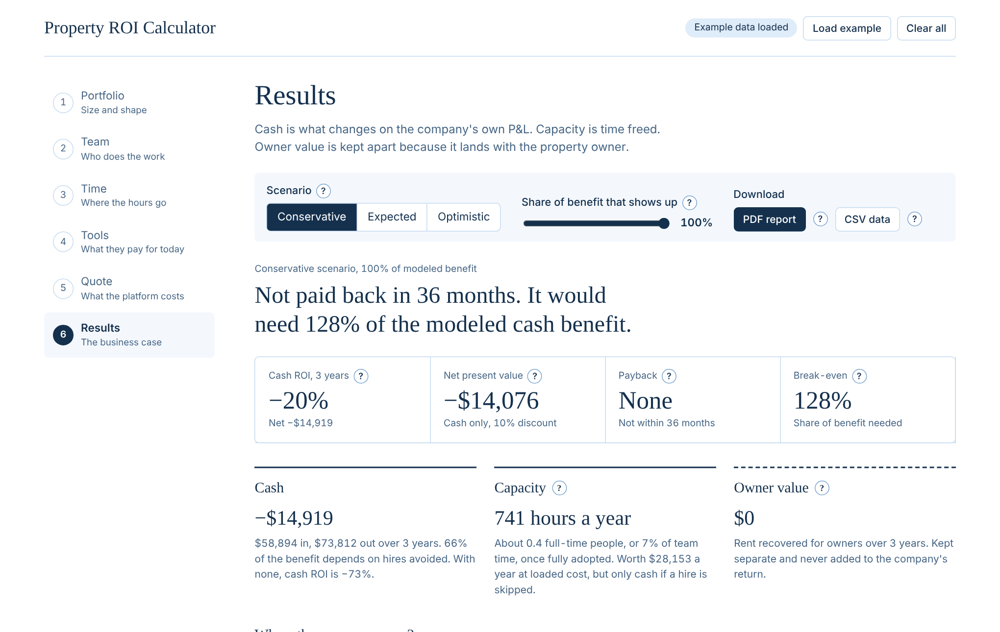
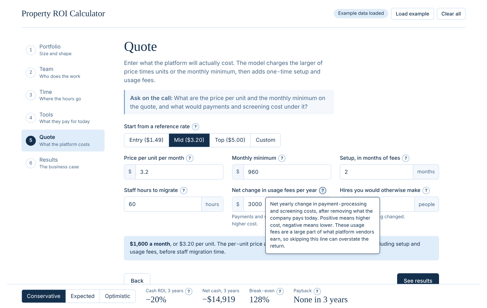

# Property ROI Calculator

[](https://github.com/SahilH-spec/pm_ROI_calculator/actions/workflows/ci.yml)

A discovery-call ROI calculator for residential property management companies evaluating a switch to a modern, integrated property management platform. It is vendor-neutral: the platform being evaluated is just three inputs (price per unit, monthly minimum, usage fees).

**Live demo:** https://sahilh-spec.github.io/pm_ROI_calculator/



## Why it is built this way

Most ROI calculators multiply "hours saved" by a wage and call the total savings. This one separates three things that are easy to blur:

- **Cash**: changes to the company's own P&L (tools cancelled, hires avoided, management-fee revenue).
- **Capacity**: staff hours freed but not yet converted to money. Real, but it is a decision what to do with them.
- **Owner value**: money that lands with the property owner. Shown separately and never added to the company's return.

Other design choices:

- **Break-even first.** The headline is "you need X% of the modeled benefit for this to pay for itself", not a single optimistic number.
- **Complete cost side.** Subscription, monthly minimum, setup months, migration time and usage fees (payments, screening). Usage-based revenue is the majority of revenue for at least one large platform vendor, so ignoring it overstates the return.
- **Conservative by default.** Three scenarios, an adoption ramp, and a discount for companies already on a modern system.
- **Honest about what drives the result.** In the test portfolios, avoided hires were 76 to 86% of the expected cash benefit and tool consolidation alone never paid for the software. The results screen shows how much of the benefit depends on hires and what ROI looks like without them.
- **Every number is the prospect's input or has a source tier**: A (government or filed data), B (industry body), C (vendor or secondary), J (my judgment). Judgment calls are labeled as judgment.

Full reasoning, formulas and the verification log are in [docs/METHODOLOGY.md](docs/METHODOLOGY.md). Sourced assumptions are in [data/assumptions.json](data/assumptions.json).

## Using it

Five steps, each with a short explanation and a "?" on every field that explains what it asks and where the default came from.

1. **Portfolio**: units, rent, turnovers, management fee, growth, current setup
2. **Team**: roles, headcount, salaries (defaults are BLS medians)
3. **Time**: weekly hours per role across nine workflows
4. **Tools**: what they pay for today, how much goes away, months left on contract
5. **Quote**: price per unit, minimum, setup, migration, usage-fee change, planned hires
6. **Results**: scenario switch, a slider for "what if only part of the benefit shows up", charts, and downloads

Results can be downloaded as a **PDF report** or a **CSV** (inputs, three scenarios, 36-month schedule). Everything runs in the browser. Nothing is stored or sent anywhere.



## Run it

It is one static file. Open `index.html` in a browser, or serve the repo root.

```bash
node app/build.js          # rebuild index.html from app/src and app/engine.js
node app/parity.test.js    # check the JavaScript engine against the Python reference
python3 reference/run.py   # run the reference model on three invented portfolios with invariant checks
```

No dependencies to install. The PDF export loads jsPDF 2.5.1 from cdnjs.

## Layout

| Path | What it is |
|---|---|
| `index.html` | Built, standalone calculator (served by GitHub Pages) |
| `app/engine.js` | The model: pure functions, no DOM |
| `app/src/` | Screens, help text, PDF and CSV export, styles (design tokens at the top of `styles.css`) |
| `app/parity.test.js` | 414 comparisons between the JS engine and the Python reference |
| `reference/` | Python reference model, invented test fixtures and invariant checks |
| `docs/METHODOLOGY.md` | Formulas, scenarios, verification, source quality |
| `data/assumptions.json` | Sourced inputs with tier and confidence |

## Limits

- The percentage of time saved per workflow, the adoption ramp, the current-setup factors and the hire credit are judgment calls. No independent time-and-motion study was found to source them from. They are labeled as such in the app and in the exports.
- Platform reference rates are last-published or third-party-reported prices and may be out of date. Replace them with a real quote.
- The three test portfolios are invented fixtures, not benchmarks.
- This is an estimate for a conversation, not a guarantee of results.

## License

MIT. See [LICENSE](LICENSE).
